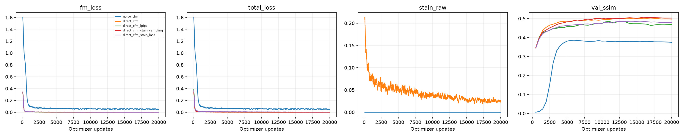

# Experiment tracking: internal logging dashboard

Saved configurations, training histories, metrics and diagnostic figures. We use this page to navigate our saved run records.

[HER2match runs and curves](#her2match-runs-and-curves) · [MIST-HER2 evaluation](#evaluation-summary) · [MIST-HER2 run records](#runs-and-artifacts) · [Failure examples](#failure-examples)

## Hosted runs

- [vp-cfm: run 1](https://www.kaggle.com/code/marritau/variance-preserving)
- [vp-cfm: run 2](https://www.kaggle.com/code/marritau/vp-cfm-generation-metrics)
- [exact-ot-cfm: run 1](https://www.kaggle.com/code/marritau/ot-cfm)
- [exact-ot-cfm: run 2](https://www.kaggle.com/code/marritau/ot-cfm-evaluation)
- [dab-sampling: run 1](https://www.kaggle.com/code/marritau/sampling-ablations)
- [error-audit: run 1](https://www.kaggle.com/code/marritau/error-audit)

## HER2match runs and curves

We compare five runs on the same 252 selected pairs (63 per slide-level HER2 score). This is an exploratory follow-up on an already inspected test cohort, not an independent confirmation. [Selection and scope](../HER2Match/results/her2match/selection.json) · [Notebook and run instructions](../HER2Match/README.md)

| Run | SSIM ↑ | FID ↓ | KID ×1000 ↓ | Config | Metrics | Training history |
|---|---:|---:|---:|---|---|---|
| noise cfm | 0.3192 | 221.79 | 218.74 | [JSON](../HER2Match/results/her2match/runs/noise_cfm/recorded_config.json) | [JSON](../HER2Match/results/her2match/runs/noise_cfm/recorded_metrics.json) | [CSV.gz](../HER2Match/results/her2match/runs/noise_cfm/history.csv.gz) |
| direct cfm | 0.3968 | 151.32 | 99.04 | [JSON](../HER2Match/results/her2match/runs/direct_cfm/recorded_config.json) | [JSON](../HER2Match/results/her2match/runs/direct_cfm/recorded_metrics.json) | [CSV.gz](../HER2Match/results/her2match/runs/direct_cfm/history.csv.gz) |
| direct cfm lpips | 0.3880 | 131.26 | 81.47 | [JSON](../HER2Match/results/her2match/runs/direct_cfm_lpips/recorded_config.json) | [JSON](../HER2Match/results/her2match/runs/direct_cfm_lpips/recorded_metrics.json) | [CSV.gz](../HER2Match/results/her2match/runs/direct_cfm_lpips/history.csv.gz) |
| direct cfm stain sampling | 0.4085 | 158.09 | 113.04 | [JSON](../HER2Match/results/her2match/runs/direct_cfm_stain_sampling/recorded_config.json) | [JSON](../HER2Match/results/her2match/runs/direct_cfm_stain_sampling/recorded_metrics.json) | [CSV.gz](../HER2Match/results/her2match/runs/direct_cfm_stain_sampling/history.csv.gz) |
| direct cfm stain loss | 0.3902 | 150.93 | 98.67 | [JSON](../HER2Match/results/her2match/runs/direct_cfm_stain_loss/recorded_config.json) | [JSON](../HER2Match/results/her2match/runs/direct_cfm_stain_loss/recorded_metrics.json) | [CSV.gz](../HER2Match/results/her2match/runs/direct_cfm_stain_loss/history.csv.gz) |

[Per-class metrics](../HER2Match/results/her2match/per_class_comparison.csv) · [Staining and reconstruction metrics](../HER2Match/results/her2match/comparison.csv) · [Fixed image comparisons](../HER2Match/results/her2match/figures/) · [Run provenance](../HER2Match/results/her2match/provenance.json)

Each run directory also includes per-image and staining metrics. The compressed CSV files contain the original training histories; the figure above provides a quick visual overview.

## Evaluation summary

Metrics below use different evaluation populations. Compare within a protocol; do not rank the 350-image subset against the full test.

| Method | Scope | Images | SSIM ↑ | FID ↓ | KID ×1000 ↓ | Source |
|---|---|---:|---:|---:|---:|---|
| Exact OT-CFM | full test | 1053 | 0.1682 | 186.58 | 191.55 | [JSON](../mist-her2/exact-ot-cfm/results/exact-ot-cfm-512-full-test/exact-ot-cfm-512-full-test/evaluation/metrics.json) |
| VP-CFM | full test | 1053 | 0.1447 | 367.41 | 469.09 | [JSON](../mist-her2/vp-cfm/results/vp-cfm-final-results/evaluation/metrics.json) |
| dab-balanced | selected test subset | 350 | 0.1694 | 365.75 | 454.73 | [JSON](../mist-her2/dab-sampling/results/mist-dab-ablation-first350-reports/mist-dab-ablation-first350-metrics/dab-balanced/evaluation/metrics.json) |
| dab-alignment-balanced | selected test subset | 350 | 0.1757 | 327.90 | 382.83 | [JSON](../mist-her2/dab-sampling/results/mist-dab-ablation-first350-reports/mist-dab-ablation-first350-metrics/dab-alignment-balanced/evaluation/metrics.json) |

## Runs and artifacts

### Conditional FM baseline

We record baseline training history and two qualitative examples in this folder.

[Experiment notes](../mist-her2/baseline/README.md)

- [results/notebook-history.jsonl](../mist-her2/baseline/results/notebook-history.jsonl)

### Crop-size study: 256 pixels

We use this folder for the exported crop-size comparison and DAB example panel. Quantitative results with machine-readable provenance are listed separately in the tracking index.

[Experiment notes](../mist-her2/crop-256/README.md)

### Variance-preserving CFM

Full group-disjoint test metrics for 1,053 images, training configuration/history and qualitative results.

[Experiment notes](../mist-her2/vp-cfm/README.md)

- [results/figures+train/her2-vp-cfm-group-disjoint-train/config.json](../mist-her2/vp-cfm/results/figures+train/her2-vp-cfm-group-disjoint-train/config.json)
- [results/figures+train/her2-vp-cfm-group-disjoint-train/history.jsonl](../mist-her2/vp-cfm/results/figures+train/her2-vp-cfm-group-disjoint-train/history.jsonl)
- [results/figures+train/her2-vp-cfm-group-disjoint-train/run.json](../mist-her2/vp-cfm/results/figures+train/her2-vp-cfm-group-disjoint-train/run.json)
- [results/notebook-history.jsonl](../mist-her2/vp-cfm/results/notebook-history.jsonl)
- [results/vp-cfm-final-results/evaluation/metrics.json](../mist-her2/vp-cfm/results/vp-cfm-final-results/evaluation/metrics.json)
- [results/vp-cfm-final-results/sampling.json](../mist-her2/vp-cfm/results/vp-cfm-final-results/sampling.json)

### Exact OT-CFM: baseline architecture

Full group-disjoint test metrics for 1,053 images and evaluation provenance. The training notebook is included; checkpoints and full predictions are external.

[Experiment notes](../mist-her2/exact-ot-cfm/README.md)

- [results/exact-ot-cfm-512-full-test/exact-ot-cfm-512-full-test/evaluation/metrics.json](../mist-her2/exact-ot-cfm/results/exact-ot-cfm-512-full-test/exact-ot-cfm-512-full-test/evaluation/metrics.json)

### Exploratory guided OT-CFM

12 validation crops. Changes in architecture and sampling prevent attributing the result to OT alone.

[Experiment notes](../mist-her2/ot-cfm-preview/README.md)

- [results/notebook-history.jsonl](../mist-her2/ot-cfm-preview/results/notebook-history.jsonl)

### Phikon and structure/stain guidance

12 validation crops. Available recipe modes are not equivalent to completed ablations.

[Experiment notes](../mist-her2/phikon-guidance/README.md)

- [results/notebook-history.jsonl](../mist-her2/phikon-guidance/results/notebook-history.jsonl)

### Direct flow with Phikon

8 validation crops and a one-example solver check. The saved setup starts from scratch (`INITIALIZE_FROM=None`).

[Experiment notes](../mist-her2/direct-phikon/README.md)

- [results/notebook-history.jsonl](../mist-her2/direct-phikon/results/notebook-history.jsonl)

### DAB-aware training-pair sampling

Training histories are available. Evaluation covers 350 selected test images, not the full 1,053-image test split.

[Experiment notes](../mist-her2/dab-sampling/README.md)

- [results/dab-sampling-ablation-training/dab-sampling-ablation-training/runs/her2-cfm-512-dab-alignment-balanced/config.json](../mist-her2/dab-sampling/results/dab-sampling-ablation-training/dab-sampling-ablation-training/runs/her2-cfm-512-dab-alignment-balanced/config.json)
- [results/dab-sampling-ablation-training/dab-sampling-ablation-training/runs/her2-cfm-512-dab-alignment-balanced/history.jsonl](../mist-her2/dab-sampling/results/dab-sampling-ablation-training/dab-sampling-ablation-training/runs/her2-cfm-512-dab-alignment-balanced/history.jsonl)
- [results/dab-sampling-ablation-training/dab-sampling-ablation-training/runs/her2-cfm-512-dab-alignment-balanced/run.json](../mist-her2/dab-sampling/results/dab-sampling-ablation-training/dab-sampling-ablation-training/runs/her2-cfm-512-dab-alignment-balanced/run.json)
- [results/dab-sampling-ablation-training/dab-sampling-ablation-training/runs/her2-cfm-512-dab-balanced/config.json](../mist-her2/dab-sampling/results/dab-sampling-ablation-training/dab-sampling-ablation-training/runs/her2-cfm-512-dab-balanced/config.json)
- [results/dab-sampling-ablation-training/dab-sampling-ablation-training/runs/her2-cfm-512-dab-balanced/history.jsonl](../mist-her2/dab-sampling/results/dab-sampling-ablation-training/dab-sampling-ablation-training/runs/her2-cfm-512-dab-balanced/history.jsonl)
- [results/dab-sampling-ablation-training/dab-sampling-ablation-training/runs/her2-cfm-512-dab-balanced/run.json](../mist-her2/dab-sampling/results/dab-sampling-ablation-training/dab-sampling-ablation-training/runs/her2-cfm-512-dab-balanced/run.json)
- [results/mist-dab-ablation-first350-reports/mist-dab-ablation-first350-metrics/dab-alignment-balanced/evaluation/metrics.json](../mist-her2/dab-sampling/results/mist-dab-ablation-first350-reports/mist-dab-ablation-first350-metrics/dab-alignment-balanced/evaluation/metrics.json)
- [results/mist-dab-ablation-first350-reports/mist-dab-ablation-first350-metrics/dab-balanced/evaluation/metrics.json](../mist-her2/dab-sampling/results/mist-dab-ablation-first350-reports/mist-dab-ablation-first350-metrics/dab-balanced/evaluation/metrics.json)

### Dataset and prediction audit

The multi-model audit compares baseline-256 and VP-CFM on 1,053 IDs at audit resolution 256. These are diagnostic metrics, not headline full-resolution scores.

[Experiment notes](../mist-her2/error-audit/README.md)

- [results/mist-multimodel-error-audit/mist-multimodel-error-audit/aggregate_metrics.csv](../mist-her2/error-audit/results/mist-multimodel-error-audit/mist-multimodel-error-audit/aggregate_metrics.csv)
- [results/mist-multimodel-error-audit/mist-multimodel-error-audit/diagnostic_flags.json](../mist-her2/error-audit/results/mist-multimodel-error-audit/mist-multimodel-error-audit/diagnostic_flags.json)
- [results/mist-multimodel-error-audit/mist-multimodel-error-audit/stratified_metrics.csv](../mist-her2/error-audit/results/mist-multimodel-error-audit/mist-multimodel-error-audit/stratified_metrics.csv)

### Archived duplicate OT notebook

We retain this earlier copy for traceability and exclude it from the count of independent experiments.

[Experiment notes](../mist-her2/archive/ot-cfm-duplicate/README.md)

- [results/notebook-history.jsonl](../mist-her2/archive/ot-cfm-duplicate/results/notebook-history.jsonl)

## Failure examples

[High-DAB underestimation](../mist-her2/error-audit/results/figures/gallery_high_dab_underestimate.png) · [False staining](../mist-her2/error-audit/results/figures/gallery_false_positive_dab.png) · [Alignment problems](../mist-her2/error-audit/results/figures/gallery_pair_alignment_problem.png)

## Availability

We manage checkpoints and complete prediction sets separately from the source repository. Hosted notebooks may require Kaggle login and access to their Inputs/Outputs. The extracted records remain readable without a Kaggle session. We use the linked Kaggle runs and saved histories as our experiment records.

## Notebook figures and console output

- [archive: saved output](../mist-her2/archive/ot-cfm-duplicate/results/notebook-outputs/README.md)
- [baseline: saved output](../mist-her2/baseline/results/notebook-outputs/README.md)
- [dab-sampling: saved output](../mist-her2/dab-sampling/results/notebook-outputs/README.md)
- [direct-phikon: saved output](../mist-her2/direct-phikon/results/notebook-outputs/README.md)
- [error-audit: saved output](../mist-her2/error-audit/results/notebook-outputs/README.md)
- [exact-ot-cfm: saved output](../mist-her2/exact-ot-cfm/results/notebook-outputs/README.md)
- [ot-cfm-preview: saved output](../mist-her2/ot-cfm-preview/results/notebook-outputs/README.md)
- [phikon-guidance: saved output](../mist-her2/phikon-guidance/results/notebook-outputs/README.md)
- [vp-cfm: saved output](../mist-her2/vp-cfm/results/notebook-outputs/README.md)
